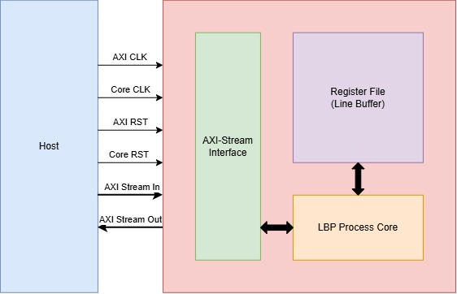
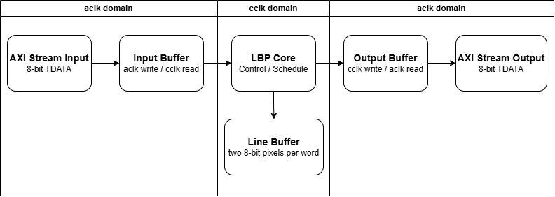
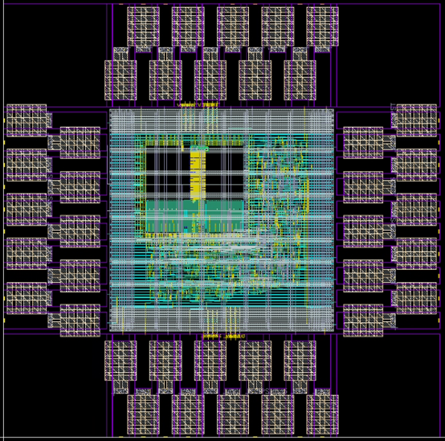
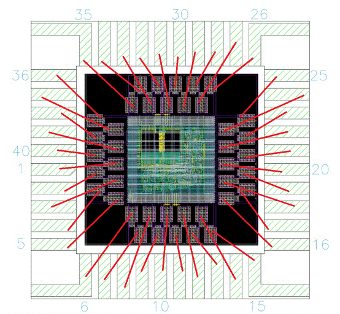

# Dual-Clock AXI4-Stream LBP Processor

A Local Binary Pattern (LBP) image processor with an on-chip line buffer and a look-ahead data-reuse schedule, taped out in TSMC 0.18 µm CMOS through the Taiwan Semiconductor Research Institute (TSRI).

The chip accepts a 128 × 128 8-bit grayscale frame over an AXI4-Stream slave interface and returns the corresponding 8-bit LBP map over an AXI4-Stream master interface at one pixel per interface clock. The streaming interface runs at 66.67 MHz and the LBP core runs at 200 MHz.

**Status:** Fabrication in progress. Silicon measurement is planned on an Advantest V93000 PS1600 tester at TSRI.

<p align="center">
  
</p>

## Contents

- [Specifications](#specifications)
- [Architecture](#architecture)
- [Interface](#interface)
- [Implementation Results](#implementation-results)
- [Verification](#verification)
- [Repository Structure](#repository-structure)
- [Running the Flow](#running-the-flow)
- [Third-Party and Proprietary Components](#third-party-and-proprietary-components)
- [Acknowledgments](#acknowledgments)

## Specifications

| Parameter | Value |
|---|---|
| Technology | TSMC 0.18 µm CMOS, 1P6M, 1.8 V core |
| Standard cells / I/O | TSRI (CIC) CBDK for TSMC 0.18 µm (Arm) |
| Core clock (`cclk`) | 200 MHz |
| Interface clock (`aclk`) | 66.67 MHz, related to `cclk` by an integer ratio of 1:3 |
| Interfaces | 8-bit AXI4-Stream slave and master, with `TLAST` and backpressure |
| Throughput | 1 pixel per `aclk` cycle (66.67 Mpixel/s) |
| Frame format | 128 × 128, Mono8, raster-scan order |
| On-chip memory | 136 × 16-bit single-port register file (272 bytes) |
| Die size | 0.78 mm × 0.78 mm |
| Package pins | 40 (26 signal, 14 power) |
| Power | 46.5 mW (post-layout, see [Power](#power)) |

## Architecture

### LBP definition

For each center pixel $g_c$ and its eight neighbors $g_p$:

```math
\mathrm{LBP}(x, y) = \sum_{p=0}^{7} s(g_p - g_c)\,2^{p},
\qquad
s(z) =
\begin{cases}
1, & z \ge 0 \\
0, & z < 0
\end{cases}
```

Bits 0 through 7 correspond to the TL, T, TR, L, R, BL, B and BR neighbors. Border pixels, which lack a complete 3 × 3 neighborhood, output 0, so every input frame produces exactly 16,384 output samples.

### Clocking and data movement

The design has two clock domains. Each domain has its own reset synchronizer with asynchronous assertion and synchronous deassertion.

| Domain | Clock | Function |
|---|---|---|
| Interface | `aclk`, 66.67 MHz | AXI4-Stream handshakes and the read side of the output buffer |
| Core | `cclk`, 200 MHz | LBP computation and line-buffer access |

Two 4-entry elastic buffers decouple the domains. The input buffer holds `{TLAST, pixel[7:0]}` and the output buffer holds `{TLAST, LBP[7:0]}`. Because the two clocks are related, the buffers absorb the small phase offset between them and no asynchronous FIFO is needed.

Backpressure propagates end to end:

1. When `m_axis_tready` is deasserted, the output buffer retains completed results.
2. When the output buffer approaches full, the core stops committing new results.
3. The input buffer then fills and `s_axis_tready` is deasserted.

`TDATA` and `TLAST` remain stable during every stall, as AXI4-Stream requires.

<p align="center">
  
</p>

### Look-ahead computation

A conventional implementation buffers enough rows to assemble the full 3 × 3 window around each center pixel, then evaluates all eight comparisons at once. This design instead uses the raster-scan arrival order. Each incoming pixel `g[n]` is treated as a future neighbor of several pending center pixels, and each center's LBP code is completed incrementally over three consecutive tokens:

| Stage | Bits resolved | Description |
|---|---|---|
| `next_lbp` | TL, L, BL | A new candidate center enters the pipeline |
| `curr_lbp` | T, R, B | The candidate advances and resolves its middle column |
| `prev_lbp` | TR, BR | The final two bits are resolved and the code is complete |

For the current input `g[n]`, the operands come from three sources:

- **Bottom neighbors:** the current input `g[n]`, used directly.
- **Top neighbor `g[n−256]` and new right neighbor `g[n−127]`:** fetched from the line buffer.
- **Center and horizontal neighbors:** shifted through `right_value → next → curr → prev` registers, so the center pixel is never re-read from memory.

In an earlier single-clock implementation targeting the 2016 IC Design Contest LBP problem, this scheme reduced area × time by about 6.7× compared with a conventional line-buffer architecture.

### Line buffer

The line buffer is a single 136 × 16-bit single-port register file. Each word stores a horizontally adjacent pixel pair, `{odd_pixel, even_pixel}`, so every read returns operands for two consecutive tokens. With this packing, every two input pixels require only:

- one RIGHT pair read
- one UP pair read
- one pair write

This access rate fits within the single-port constraint. Three modulo-136 pointers manage the buffer: `pair_write_ptr`, `right_pair_ptr` and `up_pair_ptr`. They keep a fixed separation and advance together after each odd-column write.

### Core schedule and timing closure

Each input token is processed in three `cclk` cycles, `ST_READY → ST_PHASE1 → ST_PHASE2` (3 × 5 ns = 15 ns). This matches one 66.67 MHz `aclk` period, so the core sustains one pixel per interface cycle when the output is not stalled.

| Phase | Operations |
|---|---|
| `ST_READY` | Accept the token, register partial comparison results, advance the candidate and partial-LBP registers |
| `ST_PHASE1` | Merge RIGHT and UP comparisons; issue the RF access prepared in the previous cycle |
| `ST_PHASE2` | Merge the DOWN comparison; capture RF read data |

Two techniques close timing at 200 MHz:

- **Split comparisons.** Each 8-bit unsigned comparison is divided into high-nibble and low-nibble stages. `ST_READY` registers only `hi_gt`, `hi_eq` and `lo_ge`, and later phases combine them. This keeps the full comparison, the neighbor selection and the register updates out of a single path.
- **Pre-registered RF commands.** The register file's `A`, `CEN`, `WEN` and `D` pins are driven directly from `rf_cmd_*_pre` registers prepared one cycle earlier. The memory inputs therefore get close to a full core cycle of setup time, and address generation and backpressure logic stay out of the RF setup path.

## Interface

| Signal | Direction | Width | Description |
|---|---|---|---|
| `aclk` | In | 1 | AXI4-Stream interface clock, 66.67 MHz |
| `aresetn` | In | 1 | Active-low reset for the `aclk` domain |
| `cclk` | In | 1 | Core clock, 200 MHz |
| `cresetn` | In | 1 | Active-low reset for the `cclk` domain |
| `s_axis_tvalid` | In | 1 | Input pixel valid |
| `s_axis_tready` | Out | 1 | Input ready |
| `s_axis_tdata` | In | 8 | Input grayscale pixel |
| `s_axis_tlast` | In | 1 | Last pixel of the frame |
| `m_axis_tvalid` | Out | 1 | Output LBP valid |
| `m_axis_tready` | In | 1 | Downstream ready |
| `m_axis_tdata` | Out | 8 | Output LBP code |
| `m_axis_tlast` | Out | 1 | Last LBP code of the frame |

## Implementation Results

All results are post-layout and come from Cadence Innovus unless noted otherwise.

### Timing

Static timing analysis used OCV mode with CPPR enabled for both setup and hold.

| Corner | Voltage / Temperature | Early derate | Late derate |
|---|---|---|---|
| `DC_max` | 1.62 V / 125 °C | 0.9 | 1.0 |
| `DC_min` | 1.98 V / −40 °C | 1.0 | 1.1 |

| Launch → Capture | Setup WNS |
|---|---|
| `cclk` → `cclk` | +0.031 ns |
| `aclk` → `cclk` | +2.962 ns |
| `cclk` → `aclk` | +3.079 ns |
| `aclk` → `aclk` | +1.209 ns |

### Power

Switching activity came from the full-frame testbench as an FSDB, with 100% annotation coverage (1,254 / 1,254 nets).

| Component | Power | Share |
|---|---|---|
| Internal | 29.54 mW | 63.5% |
| Switching | 16.94 mW | 36.4% |
| Leakage | 0.009 mW | < 0.1% |
| **Total** | **46.50 mW** | |

The worst-case VDD IR drop is about 1.3 mV, well below the 90 mV limit.

### Area

| Region | Area (µm²) | Share |
|---|---|---|
| Full chip | 608,585 | 100.0% |
| I/O pads and bonding pads | 440,389 | 72.4% |
| Power ring | 72,024 | 11.8% |
| Register file | 41,826 | 6.9% |
| Control and datapath logic | 29,219 | 4.8% |

The die is pad-limited. The core logic, excluding the register file, occupies less than 5% of the chip area.

<p align="center">
  
  &nbsp;&nbsp;
  
</p>

## Verification

- **Testbench.** The testbench is adapted from the 2016 IC Design Contest LBP problem. A wrapper (`AXI_LBP_CDC.v`) converts the original address-based fixture into AXI4-Stream transactions. The testbench streams a full 128 × 128 frame and checks every output against a golden reference.
- **Simulation.** RTL, pre-layout gate-level (synthesis SDF) and post-layout gate-level (Innovus SDF) simulations were run in Synopsys VCS. All 16,384 outputs matched in every run, with no dropped or duplicated samples and no misplaced `TLAST`.
- **Physical verification.** DRC, LVS and antenna checks are clean in Siemens Calibre. The only remaining DRC items are pad-related violations on TSRI's published waiver list.

## Repository Structure

```text
.
├── rtl/
│   ├── CHIP.v               Top level: I/O pads, reset synchronizers, core instance
│   └── CORE.v               Elastic buffers, look-ahead LBP engine, line-buffer control
├── tb/iccontest/
│   ├── testfixture.v        Frame-level testbench
│   ├── AXI_LBP_CDC.v        Address-based to AXI4-Stream adapter
│   ├── pattern1.dat         Input frame
│   ├── golden1.dat          Expected LBP output
│   ├── run_rls.sh           RTL simulation
│   └── run_gls.sh           Gate-level simulation with SDF
├── syn/
│   ├── .synopsys_dc.setup
│   ├── CHIP_syn.sdc         Synthesis constraints
│   ├── script_dc.tcl        Design Compiler flow
│   └── script_lc.tcl        Register-file .lib to .db conversion
├── pnr/
│   ├── mmmc.view.stylus     Multi-mode multi-corner setup
│   ├── CHIP_func.sdc        Implementation constraints
│   ├── CHIP.io              Pad ring definition
│   ├── 01_design_init.tcl
│   ├── 02_floorplan.tcl
│   ├── 04_placement.tcl
│   ├── 05_clock_tree_synthesis.tcl
│   ├── 06_route.tcl
│   ├── cts_config.tcl
│   ├── place_sram.tcl
│   └── scripts.tcl          GDS stream-out and SDF generation
├── ip/rf136x16m4h3v2/
│   └── rf136x16m4h3v2.v     Port-only placeholder for the register file
└── docs/
    ├── design_report.pdf    Full design report (Traditional Chinese)
    └── assets/              Figures used in this README
```

## Running the Flow

### Prerequisites

- **Tools:** Synopsys VCS, Design Compiler and Library Compiler; Cadence Innovus (Stylus UI); Siemens Calibre.
- **Libraries:** the TSRI TSMC 0.18 µm CBDK, plus the register-file views (`.lib`, `.lef`, `.gds2`, Verilog model) generated by the memory compiler. Neither is included in this repository; see [Third-Party and Proprietary Components](#third-party-and-proprietary-components).

The scripts reference library paths under `/process/T18/...` as laid out on the TSRI EDA Cloud, and the simulation scripts submit jobs with LSF `bsub`. Adjust both for your environment.

### RTL simulation

The simulation scripts use paths relative to a directory two levels below the repository root.

```bash
mkdir -p sim/iccontest && cd sim/iccontest
bash ../../tb/iccontest/run_rls.sh
```

### Synthesis

```bash
cd syn
lc_shell -f script_lc.tcl     # compile register-file .lib files into .db
dc_shell -f script_dc.tcl     # writes out/CHIP_syn.{v,sdc,sdf,ddc} and rpt/
```

### Gate-level simulation

```bash
cd sim/iccontest
bash ../../tb/iccontest/run_gls.sh
```

### Placement and routing

```bash
cd pnr
bash script_copy.sh           # copy TSRI-provided pad and stream-out support files
innovus -stylus
```

Then run these scripts in order from the Innovus prompt:

```tcl
source 01_design_init.tcl
source 02_floorplan.tcl
# Step 03 (power planning) is not included in this repository.
source 04_placement.tcl
source 05_clock_tree_synthesis.tcl
source 06_route.tcl
```

## Third-Party and Proprietary Components

The following items are covered by foundry, IP-vendor or TSRI agreements and are intentionally excluded from this repository:

- Standard-cell and I/O libraries (`.lib`, `.db`, `.lef`, `.gds`, Verilog models)
- Memory-compiler outputs for `rf136x16m4h3v2` (only a port-only placeholder is provided)
- TSRI-provided support scripts, including bonding-pad, I/O-filler and stream-out files
- DRC and LVS rule decks
- Generated netlists, SDF, DEF and GDS

## Acknowledgments

- The Taiwan Semiconductor Research Institute (TSRI) provided chip fabrication and access to the EDA environment.
- National Kaohsiung University of Science and Technology (NKUST) supported this project.
- The problem definition and the original testbench come from the 2016 IC Design Contest (Preliminary, Category B): *Local Binary Patterns*.
